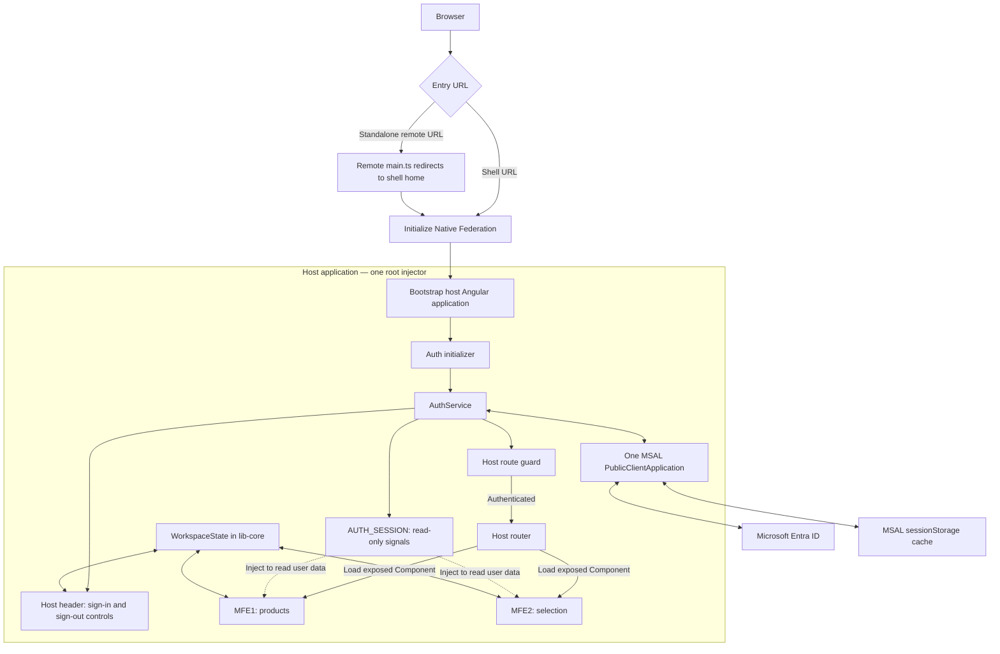
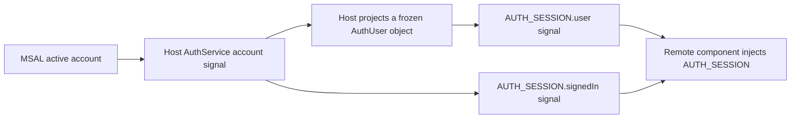
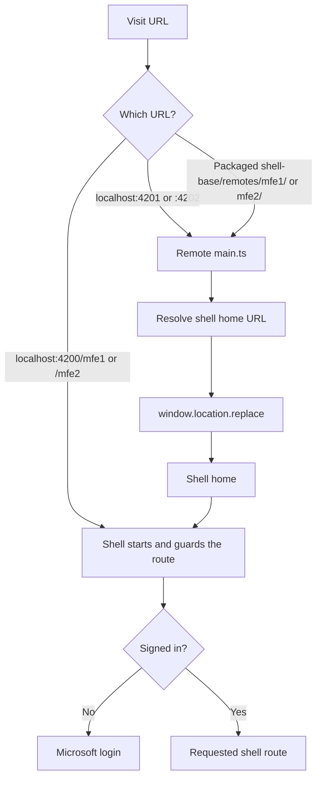
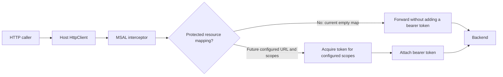

# Shell-owned authentication architecture

This document describes the implemented browser application. API token scopes and
the shared API response cache are future work. Diagrams use Mermaid.

## Ownership and runtime architecture



The host owns credentials-related operations and root providers. Remotes are
components loaded into the host application, rather than separately bootstrapped
Angular apps. `AUTH_SESSION` is provided by the host; the token and types come from
the shared `@workspace/lib-core` entry point.

The session contract is available for remote consumption. The existing products
and selection components currently use `WorkspaceState`; they do not yet render
the user's name.

| Area                     | Owns                                                                                           | Does not expose to remotes through the session contract |
| ------------------------ | ---------------------------------------------------------------------------------------------- | ------------------------------------------------------- |
| Host                     | MSAL configuration, initialization, account selection, guards, login/logout, HTTP interception | MSAL instance and authentication actions                |
| Core library             | Read-only user/session contract and shared workspace state                                     | Login/logout methods or tokens                          |
| MFE1 / MFE2              | Feature UI and feature behavior                                                                | Independent authentication lifecycle                    |
| Native Federation        | Shared module identity and runtime component loading                                           | Authentication or authorization decisions               |
| Backend, when integrated | Token validation and resource authorization                                                    | Trust in client-side route guards alone                 |

## Startup and login sequence

```mermaid
sequenceDiagram
  actor User
  participant Host as Shell main/bootstrap
  participant Init as Auth initializer
  participant Auth as Host AuthService
  participant MSAL
  participant Entra as Microsoft Entra ID
  participant Guard as Host route guard
  participant Remote as Remote component
  User->>Host: Open shell URL
  Host->>Host: Initialize federation, then bootstrap Angular
  Host->>Init: Run application initializer
  Init->>Auth: initialize()
  Auth->>MSAL: handleRedirectObservable()
  Note over Auth,MSAL: MSAL Angular initializes the client before handling redirects
  MSAL-->>Auth: Redirect result or null
  Auth->>Auth: Select redirect account, active account, or sole cached account
  Auth-->>Init: Initialization complete
  Host->>Guard: Activate requested route
  Guard->>Auth: Await initialize(), then check signedIn()
  alt Account exists
    Guard-->>Host: Allow navigation
    Host->>Remote: Load exposed component for an MFE route
  else No account
    Guard->>Auth: signIn()
    Auth->>MSAL: loginRedirect()
    MSAL->>Entra: Authorization code request with PKCE
    User->>Entra: Complete sign-in and any MFA
    Entra-->>Host: Redirect to registered shell URI with authorization response
    Note over Host,MSAL: New page repeats startup; MSAL completes code redemption
    Note over Auth,Guard: Restored account allows navigation without another login
  end
```

`initialize()` memoizes its promise, so the initializer and guard do not process
the redirect independently. Multiple cached accounts without an active account
are not selected arbitrarily; sign-in requests account selection.

Both the protected parent and its children use the guard. Child navigation is
therefore checked even when the parent route remains active. Remote component
loading is blocked when navigation is denied. The host shell itself can render
its header while navigation is pending.

## Shared user information



| Signal               | Value                                                      |
| -------------------- | ---------------------------------------------------------- |
| `session.user()`     | `null`, or `name`, `username`, `homeAccountId`, `tenantId` |
| `session.signedIn()` | Whether the host currently has an active account           |

Example for a remote component:

```ts
import { inject } from '@angular/core';
import { AUTH_SESSION } from '@workspace/lib-core';

// Inside the component class:
readonly session = inject(AUTH_SESSION);
```

```html
@if (session.user(); as user) {
<p>Welcome, {{ user.name }}</p>
}
```

Do not provide `AUTH_SESSION` again inside a remote. Do not import host auth source
or MSAL into remote feature code. ESLint rejects those imports. Federation shares
the core module so all consumers use the same injection-token identity, and the
host root injector supplies the session value.

This is a maintainable API boundary, not isolation from malicious JavaScript.
Remotes run in the same browser security context as the shell. Trusted deployment
and backend authorization remain necessary.

## Direct remote URL flow



Standalone remote entry points do not bootstrap Angular. Loading the remote's
exposed component from the shell does not execute that standalone entry point,
so authenticated navigation through the shell continues normally.

| Entry                                      | Destination/behavior                              |
| ------------------------------------------ | ------------------------------------------------- |
| `http://localhost:4201/` or `:4202/`       | `http://localhost:4200/`                          |
| `https://example.com/portal/remotes/mfe1/` | `https://example.com/portal/`                     |
| `https://example.com/portal/remotes/mfe2/` | `https://example.com/portal/`                     |
| Shell `/mfe1` or `/mfe2`                   | Guarded feature route inside shell                |
| Unknown remote production layout           | Explicit configuration error; update the resolver |

Redirects remove the standalone remote URL from the current history entry. They
do not restrict access to remote JavaScript assets or `remoteEntry.json`, which
the shell must fetch.

## Logout, account changes, and failures

```mermaid
sequenceDiagram
  actor User
  participant Header as Host header
  participant Auth as Host AuthService
  participant Session as Shared session signals
  participant MSAL
  participant Entra as Microsoft Entra ID
  User->>Header: Sign out
  Header->>Auth: signOut()
  Auth->>MSAL: logoutRedirect(active account)
  MSAL-->>Auth: LOGOUT_START event
  Auth->>Session: Clear active account; user becomes null
  MSAL->>Entra: End session
  Entra-->>Header: Return to shell home
  Note over Header,Entra: Home is protected, so a signed-out visit starts login again
```

- `ACTIVE_ACCOUNT_CHANGED` updates the host account signal and derived session.
- Interactive failures show a generic message and release the busy state for retry.
- Initialization failures reject startup and reach the existing bootstrap error handler.
- Logging out currently returns to protected home. A persistent signed-out landing
  page would require an additional public route.

## HTTP and token scope



Login currently requests `openid` and `profile`. Protected API URLs and delegated
scopes are not configured. Successful sign-in must not be treated as proof that
an access token for a business API has been acquired. Token values are not exposed
through the shared session contract.

## Source map and validation

| File                                             | Responsibility                                               |
| ------------------------------------------------ | ------------------------------------------------------------ |
| `apps/host/src/main.ts`                          | Initialize federation before importing Angular bootstrap     |
| `apps/host/src/app/app.config.ts`                | Register auth, HTTP and routing providers                    |
| `apps/host/src/app/auth.config.ts`               | Public client/tenant IDs, scopes and redirect URLs           |
| `apps/host/src/app/auth/provide-auth.ts`         | Host-only MSAL providers, initializer and session projection |
| `apps/host/src/app/auth/auth-service.ts`         | Account signals and interactive auth actions                 |
| `apps/host/src/app/auth/auth-guard.ts`           | Authentication check before route activation                 |
| `apps/host/src/app/app.routes.ts`                | Protected host and remote routes                             |
| `apps/host/src/app/app.ts` / `app.html`          | Host header and authentication buttons                       |
| `libs/lib-core/src/lib/auth/auth-session.ts`     | Shared read-only user contract                               |
| `apps/mfe1/src/main.ts`, `apps/mfe2/src/main.ts` | Standalone visit redirects                                   |
| `tools/shell-home-url.ts`                        | Local and packaged deployment URL conventions                |
| `tools/federation.config.mjs`                    | Singleton package and workspace-library sharing              |
| `eslint.config.cjs`                              | Remote import restrictions                                   |

Automated tests cover account restoration, account/tenant events, logout, login
failure, guard behavior, initialization ordering, child-injector reuse, and shell
URL resolution. Real tenant sign-in, MFA, consent and deployed redirect URI
registration require manual verification. All three federation builds must remain
valid after changes to shared contracts or entry points.

## Future API cache integration

The proposed API response cache has not been implemented. It will be a separate
shared in-memory store, not MSAL's session-storage token cache. Its identity scope
must use the host's user/tenant state, clear on logout/account changes, and reject
responses from an old identity generation. Connecting that lifecycle safely is
part of the cache implementation, not a behavior provided by this document.
